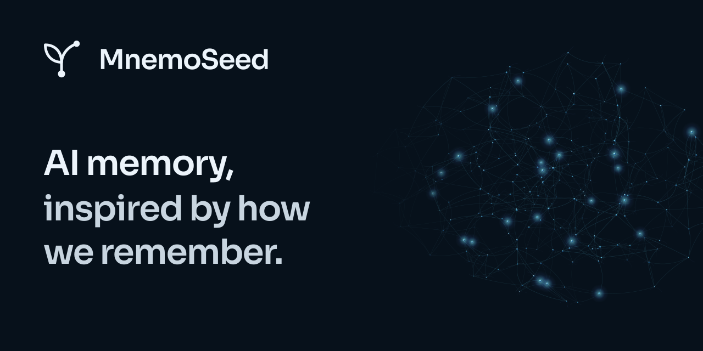

# Start with MnemoSeed Local

**Local memory for your coding agents.**

[MnemoSeed Local](https://github.com/MnemoSeed/mnemoseed-local) is the current
single-user edition: conversation capture, context retrieval, dream
consolidation, and a web console on your machine. Adapters are available for
OpenCode, Claude Code, ZCode, and Codex CLI; platform coverage varies.

- [Install Local from source](https://github.com/MnemoSeed/mnemoseed-local#install).
- [Read the guide](https://github.com/MnemoSeed/mnemoseed-local/blob/main/docs/guide.md).
- [Visit the website](https://mnemoseed.my).
- [Support development](https://github.com/sponsors/MnemoSeed).
- [Get in touch](mailto:hello@mnemoseed.my).

The broader [MnemoSeed project](https://github.com/MnemoSeed/mnemoseed) explores
memory across AI agents. Local is available from source today; multi-device sync
and a hosted cloud daemon remain future directions.
